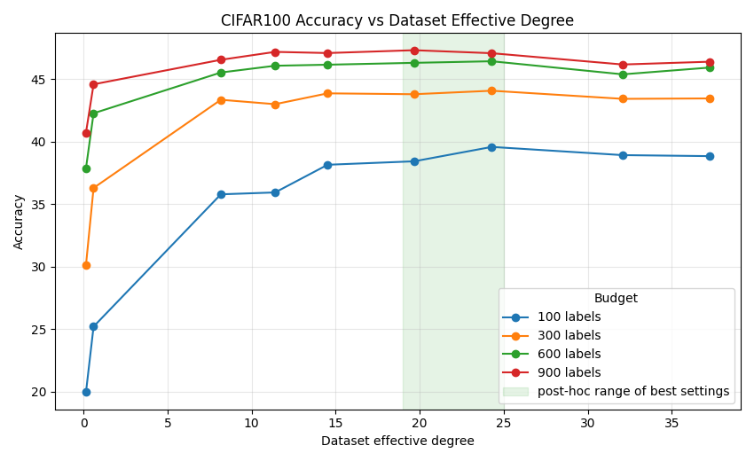
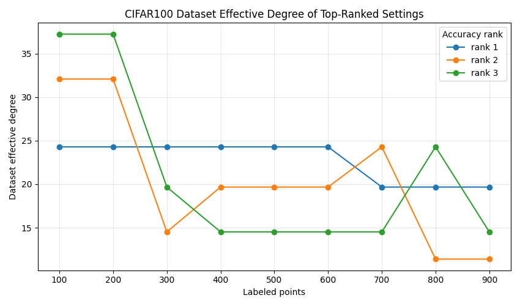
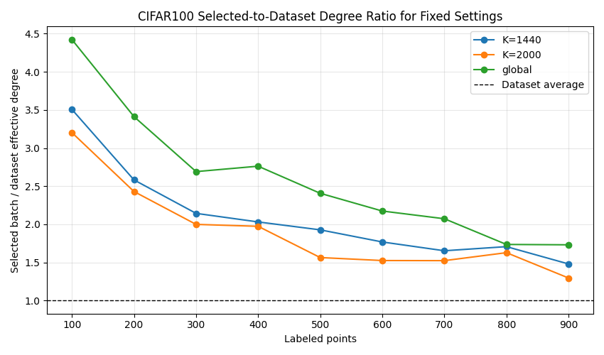
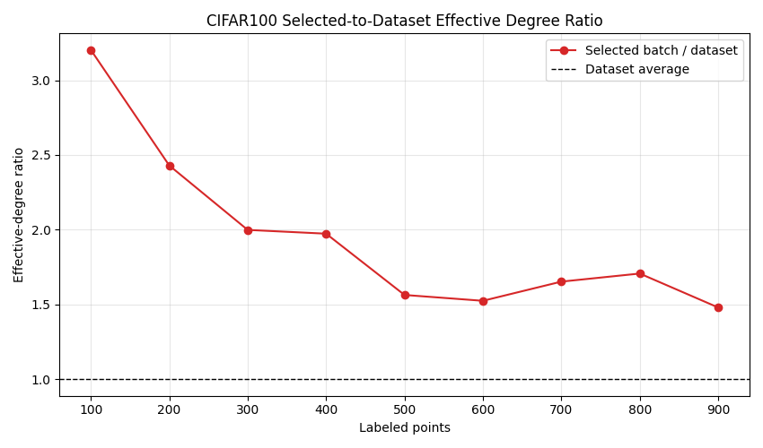
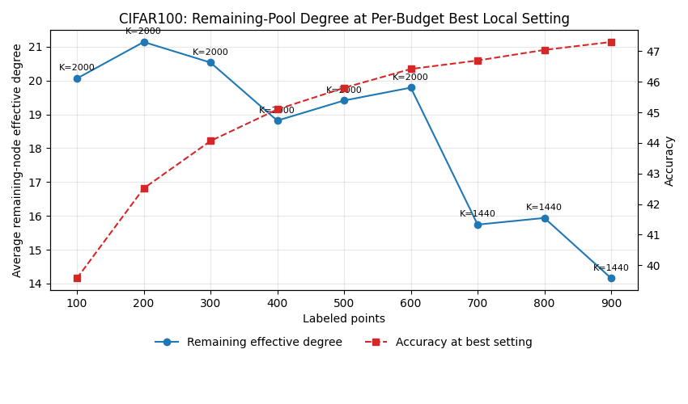
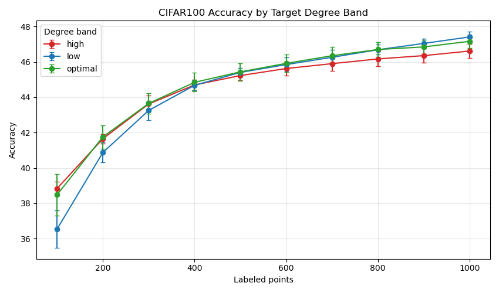
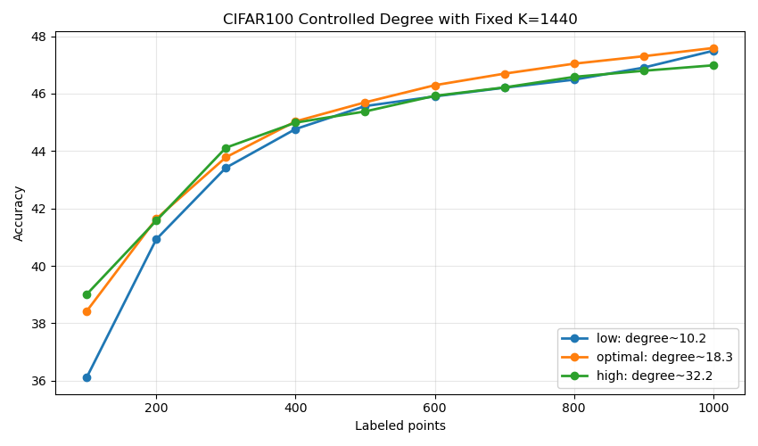
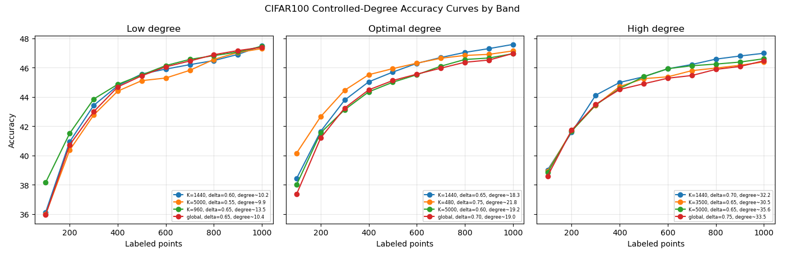

# CIFAR100 Degree/Density Follow-Up Addendum

This note summarizes the extra analysis done after Daphna's latest comments about possible invariants across budget. It is meant as a short addition to the main research summary, not as a replacement for it.

The main question we addressed here is:

Can we explain MaxHerding behavior more through graph degree/density than through the local-sigma K itself?

The answer from the new analysis is: yes, degree appears to be a useful explanatory quantity, but not as one fixed optimal number. The more accurate picture is that MaxHerding has a strong density bias early in the active-learning run, and useful settings seem to lie in a low-to-moderate graph-degree regime that changes with budget.

## 1. What Data We Gathered

We focused on CIFAR100 MaxHerding with 1NN, because this is the setting where our global reference matches the MaxHerding paper reasonably well and therefore gives us a reliable base for analysis.

For the completed CIFAR100 K-sweep runs, we extracted:

- Accuracy at each active-learning budget.
- The local-sigma K used by each run.
- The dataset effective degree induced by each K.
- The degree of the points selected at each episode.
- The degree of the remaining unlabeled pool after selections.

Here, effective degree means the average amount of graph connectivity. With cutoff, it is close to asking: how many points are connected to each point under the chosen kernel and cutoff rule?

This is important because K itself is not directly the graph density. K only determines the local sigma. The actual graph density is determined by the resulting sigma values together with the cutoff threshold.

## 2. Retrospective K-Sweep Analysis

The first analysis was retrospective. We did not control the degree directly. Instead, we took the K-sweep experiments that had already run and measured what graph degree each K produced.

For each K, we had two things:

- The accuracy curve from the active-learning run.
- The dataset effective degree induced by that K.

This lets us ask whether the results are better organized by K or by the graph degree induced by K.

### Figure 1: Accuracy vs Dataset Effective Degree

What this figure shows:

- Each point is one completed setting from the previous K sweep.
- The X axis is the dataset effective degree induced by that setting.
- The Y axis is the matching accuracy from that same setting.
- Each curve corresponds to a different labeling budget.

The shaded band is post-hoc. It was not controlled during the experiment. It marks the approximate degree range where strong K-sweep settings tended to appear.

What we learn:

- Very small degree performs poorly.
- Larger degree helps at very low budget, but not monotonically.
- At later budgets, very high degree is not clearly better and can be worse.
- This suggests that K matters partly because it controls the induced graph degree.

This figure is correlational. It does not prove that degree causes the accuracy change, because K and degree changed together in the original sweep. That is why we also ran the controlled-degree experiment below.

### Figure 2: Effective Degree of the Top 3 Settings

What this figure shows:

- For each budget, all tested K settings were ranked by accuracy.
- The plot shows the dataset effective degree of rank 1, rank 2, and rank 3.
- Rank 1 means the best accuracy at that budget.

What we learn:

- The best K does not stay fixed across budget.
- Early budgets tolerate or prefer higher degree.
- Later budgets shift toward lower/moderate degree.
- This supports the idea that a useful invariant may be a degree regime, not one specific K.

## 3. Selection and Remaining-Pool Density

Daphna asked about the average graph degree of the remaining nodes when hyperparameters are chosen at their optimal point. We measured this, but we also measured selected-point degree because it gives a more direct view of what MaxHerding is doing.

### Figure 3: Selected-to-Dataset Degree Ratio for Fixed Settings

What this figure shows:

- Each curve is one fixed setting across the whole active-learning run.
- We show global sigma, K=1440, and K=2000.
- The Y axis is:

Selected batch effective degree / dataset effective degree

A value of 1 means the selected points have average dataset density. A value above 1 means the selected batch is denser than average.

What we learn:

- For all three fixed settings, MaxHerding selects much denser-than-average points early.
- The ratio decreases as the budget grows.
- The selected batches remain above dataset average for most of the run.

This is one of the clearest pieces of evidence that degree/density is central to MaxHerding's behavior.

### Figure 4: Selected-to-Dataset Degree Ratio at the Per-Budget Best Setting

What this figure shows:

- At each budget, we first choose the best-performing setting at that budget.
- Then we measure the selected batch degree under that setting.
- The plotted value is selected batch degree divided by dataset degree.

This is different from Figure 3. Figure 3 follows fixed settings through the run. Figure 4 asks what happens if we always look at the best setting for each budget.

What we learn:

- Even under the per-budget best setting, selected points are denser than average.
- The density bias is strongest early and weakens later.
- This agrees with the fixed-setting analysis.

Figure 3 is better for showing the trend of a single full algorithm run. Figure 4 is better for asking what the empirically best setting is doing at each budget.

### Figure 5: Remaining-Pool Degree at the Per-Budget Best Local Setting

What this figure shows:

- Blue curve: average effective degree of the remaining unlabeled pool.
- Red curve: accuracy of the same best setting.
- The labels show which K was the best local setting at that budget.

Why remaining-pool degree matters:

- Active learning changes the unlabeled pool.
- If MaxHerding selects dense representative points first, then the remaining pool should become less dense.
- This plot gives a view of how the pool changes as points are selected.

What we learn:

- Remaining-pool degree generally decreases as the run progresses.
- The drop becomes especially visible when the best setting shifts from K=2000 to K=1440.
- This supports the same broader story: MaxHerding is not only improving accuracy, it is also changing the density structure of the unlabeled pool.

This plot should not be read alone as an accuracy explanation. It is most useful together with the selected-degree plots: selected points are denser than average, and the remaining pool becomes less dense.

## 4. Controlled-Degree Experiment

The retrospective analysis suggested that degree is important, but it was not enough because K and degree changed together.

To test the degree hypothesis more directly, we ran a controlled-degree experiment.

Setup:

- Dataset: CIFAR100.
- Algorithm: MaxHerding.
- Classifier: 1NN.
- Seeds: 3, 4, and 5.
- Budget: 100 labels per episode, up to 1000 labels.
- We used cutoff.
- We selected different `(K, delta)` pairs to target similar graph degrees.

Target degree bands:

- Low degree: about 10-13 effective neighbors.
- Moderate degree: about 18-23 effective neighbors.
- High degree: about 30-36 effective neighbors.

The degree bands were estimated before running the active-learning experiments by sampling points and measuring how many graph neighbors each `(K, delta)` setting produced.

### Figure 6: Controlled-Degree Accuracy by Band

What this figure shows:

- Accuracy curves grouped by target degree band.
- Each band averages several `(K, delta)` configurations and seeds.

What we learn:

- High degree is worse later in the active-learning run.
- Low and moderate degree are close and competitive.
- Degree matters, but not monotonically.

The useful conclusion is not "higher degree is better." The better conclusion is that too much degree can hurt, and MaxHerding seems to prefer a low-to-moderate degree regime on CIFAR100.

### Figure 7: Controlled Degree with Fixed K=1440

What this figure shows:

- K is fixed to 1440.
- Delta changes, which changes the effective graph degree.
- This gives low, moderate, and high degree while keeping K fixed.

Why this figure is useful:

- It isolates degree more cleanly than comparing many different K values.
- The main changing factor is the cutoff-induced degree.

What we learn:

- The moderate-degree curve is best for most of the budget range.
- High degree is not best later.
- Very low degree is worse early.

This supports the idea that the best behavior is budget-dependent and degree-dependent, not simply K-dependent.

### Figure 8: Controlled-Degree Curves Split by Band

What this figure shows:

- The controlled-degree experiment split into low, moderate, and high panels.
- Each panel shows only the configurations inside that degree band.

Why this figure is useful:

- It is easier to read than plotting all configurations together.
- It lets us see whether configurations inside the same degree band behave similarly.

What we learn:

- Curves within a degree band are relatively close, though not identical.
- Degree explains a meaningful part of the behavior.
- There are still smaller effects from the exact K and delta, so degree is not the only factor.

## 5. How This Addresses Daphna's Question

Daphna's main suggestion was to look for invariants that are robust to budget changes, for example the average graph degree of the remaining nodes when other hyperparameters are chosen optimally.

What we found:

- The remaining-pool degree is informative because it shows that the unlabeled pool becomes less dense as MaxHerding progresses.
- The selected-point degree is even more direct: MaxHerding selects denser-than-average points, especially early.
- The best K changes with budget, but the induced degree gives a more stable way to describe the behavior.
- Controlled-degree runs support the claim that degree matters, but also show that the relationship is not monotone.

The main invariant is therefore not one exact degree value.

The better statement is:

MaxHerding on CIFAR100 appears to operate best in a low-to-moderate graph-degree regime. The preferred degree shifts with budget: denser selections are useful early, while too-dense graphs become less helpful later.

## 6. Relation to the Main Research

Our original research question focused on local sigma and whether localization improves MaxHerding.

The new analysis reframes the result:

Local sigma is important mainly because it changes the graph density/degree structure. The algorithm's behavior seems more directly tied to which points have high graph degree and how dense the induced graph is.

This explains why simply increasing K made local sigma behave closer to global sigma. Large K smooths the local sigmas and produces a more global-like graph. Very small K makes the graph too sparse. The useful region is not defined only by K, but by the degree structure created by K and delta.

## 7. Current Finishing-Touch Conclusion

The main finishing result is:

Degree/density is a stronger explanatory variable than K alone for CIFAR100 MaxHerding with 1NN.

The evidence is:

- Selected points are denser than average.
- The remaining pool becomes less dense.
- Accuracy curves are better understood through induced graph degree than through K alone.
- Controlled-degree experiments show that too-high degree hurts later, and that moderate degree is often preferable.

This does not yet produce a complete new algorithm, but it gives a clearer direction:

An adaptive version of MaxHerding should probably choose K or delta according to the graph degree regime it wants to maintain at each budget, rather than treating K as a fixed hyperparameter.
