# Final Research Summary: Local Sigma, Density, and MaxHerding

This research project was conducted in Prof. Daphna Weinshall's lab under her supervision. The goal was to study how kernel locality, graph density, and selected-point density affect coverage-based active learning, with a focus on MaxHerding.

## Executive Summary

We studied whether local kernel scaling can improve active learning. Active learning is useful when labels are expensive: instead of labeling many examples at random, the algorithm chooses which examples should be labeled.

The original idea came from the Local Sigma paper. Instead of using one global distance scale for the whole dataset, each point receives a local scale based on its neighborhood. We expected this might help active learning balance dense and sparse regions of the data.

The main conclusion is that locality alone does not explain most of the behavior. The graph degree induced by the kernel appears to be more important. If the graph is too sparse, the method performs badly because points do not cover enough neighbors. If the graph is too dense, many points become too similar and dense regions dominate. The useful behavior is between these extremes.

The research therefore shifted from asking which local neighborhood size K is best, to asking what graph degree or density profile MaxHerding should induce at each labeling budget. On CIFAR100, the strongest evidence points to a useful low-to-moderate degree regime, roughly around 18-25 effective neighbors, but this regime is budget-dependent rather than one fixed global optimum.

## 1. Background

### 1.1 Active Learning and Budget

In many machine-learning problems, unlabeled data is easy to collect but labels are expensive. Active learning studies how to choose a small set of examples to label so that the resulting labeled set is as useful as possible.

This project uses pool-based active learning. We start with a fixed unlabeled pool. At each round, the algorithm selects a batch of points to label, and the selected points move from the unlabeled pool to the labeled set. The total number of labels the algorithm is allowed to request is called the budget.

We focused on low-budget active learning, where every selected point matters. Our main ranges were 10-100 labels for CIFAR10 and 100-1000 labels for CIFAR100.

### 1.2 Datasets

CIFAR10 and CIFAR100 are standard image-classification benchmarks. CIFAR10 has 10 object classes, while CIFAR100 has 100 finer-grained classes.

We used both datasets, but the final analysis focuses mostly on CIFAR100. CIFAR10 baselines often reach high accuracy with very few labels, so there is less room for improvement. CIFAR100 is harder because the budget must cover many more classes, making it more useful for studying how kernel density and selection behavior affect performance.

### 1.3 What Makes a Good Active-Learning Selection?

A good selected set should be informative and representative.

Important selection goals include:

- Cover the main regions of the data.
- Avoid choosing many redundant points.
- Include examples from different classes or clusters.
- Include rare or sparse regions when they matter.
- Improve downstream classification accuracy.

There is a natural tension:

- Dense regions contain many points and are often representative.
- Sparse regions may contain rare but important structure.
- Selecting only dense points can be redundant.
- Selecting too many sparse or outlier points can waste budget.

Much of this project is about understanding this dense-versus-sparse tradeoff.

### 1.4 Feature Space, Kernels, and Degree

The algorithms in this project usually do not operate directly on raw image pixels. Instead, each image is represented by a feature vector from a pretrained self-supervised model, such as SimCLR:

```text
image -> feature vector
```

Distances and similarities are computed between feature vectors. Coverage-based active-learning methods often turn these similarities into a graph:

- Each data point is a node.
- An edge means two points are close or similar.
- The edge weight measures similarity.

We used an RBF kernel:

$$
K_{ij} = \exp\left(-\frac{d(i,j)^2}{\sigma^2}\right)
$$

The parameter sigma controls how quickly similarity decays with distance. Small sigma creates a local graph. Large sigma creates a smoother graph where more points are similar.

The degree of a point measures how connected it is. In an unweighted graph, degree is the number of neighbors. In a weighted graph, degree is the sum of edge weights:

$$
\text{degree}(i) = \sum_j K_{ij}
$$

High-degree points are usually in dense or central regions. Low-degree points are usually in sparse or isolated regions.

In our cutoff experiments, `delta` is the threshold that decides which connections remain. Points outside the `delta` radius are treated as disconnected. Therefore, for local sigma, the graph degree is induced by the full `(K, delta)` setting: K determines the local scale, and `delta` determines which scaled distances remain connected.

## 2. Methods and Motivation

### 2.1 ProbCover

ProbCover is a coverage-based active-learning method. It creates a binary graph using a distance threshold:

$$
\text{edge}(i,j) =
\begin{cases}
1, & d(i,j) \leq \delta \\
0, & d(i,j) > \delta
\end{cases}
$$

The algorithm selects points that cover many currently uncovered points. The important idea for this project is the threshold graph: it gives a concrete notion of which points are close enough to count as neighbors.

We also used this idea inside MaxHerding as a cutoff. Without a cutoff, the RBF kernel gives every pair of points some positive similarity, even if that similarity is extremely small. With a ProbCover-style cutoff, distant points do not contribute.

### 2.2 MaxHerding

MaxHerding is a coverage/representativeness-based active-learning method. Instead of selecting points only by a binary graph, it uses a smooth kernel matrix.

A point is valuable if it helps represent or cover the remaining unlabeled distribution. The kernel controls how much one selected point represents nearby points.

Therefore, MaxHerding depends strongly on the kernel:

- If the graph is too sparse, points do not cover enough neighbors.
- If the graph is too dense, many points may look too similar.
- If dense regions dominate the graph, selection may become redundant.

This is why we studied sigma, local sigma, cutoff, graph degree, and density normalization.

### 2.3 Local Sigma

The Local Sigma idea comes from Self-Tuning Spectral Clustering by Zelnik-Manor and Perona. That paper is about clustering, not active learning, but it addresses a related kernel problem: one global sigma may not work well when the dataset has regions with different densities.

The paper proposes replacing the single global sigma with a local sigma for each point:

$$
\sigma_i = \text{distance from point } i \text{ to its K-th nearest neighbor}
$$

Then similarity is computed as:

$$
K_{ij} = \exp\left(-\frac{d(i,j)^2}{\sigma_i \sigma_j}\right)
$$

In dense regions, the K-th neighbor is close, so $\sigma_i$ is small. In sparse regions, the K-th neighbor is farther, so $\sigma_i$ is larger. This motivated our starting hypothesis: local sigma might let MaxHerding compare points more fairly across dense and sparse regions.

The key difference is that our goal is not clustering. We select a small labeled set under a label budget. A local kernel is useful only if it improves which points are selected.

## 3. Experimental Setup

The main validated setup used:

- Active-learning method: MaxHerding.
- Evaluation classifier: 1-nearest neighbor on SSL features.
- Features: fixed SimCLR/SSL features.
- Kernel: RBF kernel.
- Cutoff: ProbCover-style `delta` cutoff applied to the RBF kernel.
- Main datasets: CIFAR10 and CIFAR100.
- CIFAR10 budget range: 10 to 100 labels.
- CIFAR100 budget range: 100 to 1000 labels.

This setup was chosen because the global-sigma MaxHerding + 1NN path reproduced the expected reference behavior most reliably. Later in the project we focused mainly on CIFAR100, because it is harder than CIFAR10 and leaves more room to study improvements and failure modes.

## 4. First Direction: Local Sigma Through K

The first main experiment applied the Local Sigma idea by varying K. For each point, the local sigma is based on the distance to its K-th neighbor. Small K gives a very local scale; large K gives a smoother, more global-like scale.

The expectation was that some middle K might improve the dense/sparse selection balance.

### 4.1 Results

K mostly controlled the effective graph density.

Small K values made the graph too sparse and disconnected. These settings performed badly because many points had almost no meaningful neighbors under the cutoff rule.

Large K values made local sigmas more similar across points. These settings became close to global sigma, so they were stable but did not provide a strong localization advantage.

The useful range was medium-to-large K. On CIFAR10 this was around K=3500. On CIFAR100 this was around K=1440, with K=2000 often strong at earlier budgets. The improvements in this range were modest.

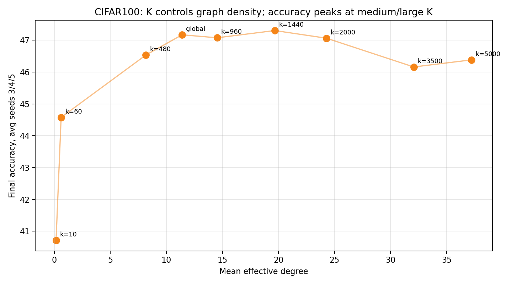

Figure 1 shows the CIFAR100 K-sweep result as a function of effective graph degree. Very small-degree graphs fail, medium-degree settings are useful, and very large K does not create a strong advantage over global sigma.

### 4.2 Interpretation

Local sigma changes the kernel, but much of the effect can be explained by the induced graph degree:

- Too low degree means the graph is fragmented.
- Moderate degree gives useful coverage.
- Very high degree becomes close to global behavior.

This shifted the research question from:

Which K is best?

to:

What graph degree or density profile should the active-learning algorithm induce at each budget?

## 5. Density and Selection Diagnostics

To understand what MaxHerding actually selects, we measured:

- Dataset-level graph degree.
- Selected-point graph degree.
- Selected-point degree normalized by dataset-average degree.
- Raw/global selected density.
- Local sigma statistics.
- Accuracy.

### 5.1 Effective Density Ratio

The effective density ratio measures whether the selected points are dense under the graph actually used by the method.

It is:

$$
\frac{\text{selected-point degree under the method's graph}}{\text{dataset-average degree under the same graph}}
$$

A value above 1 means the method selected points that are denser than the average dataset point according to its own graph.

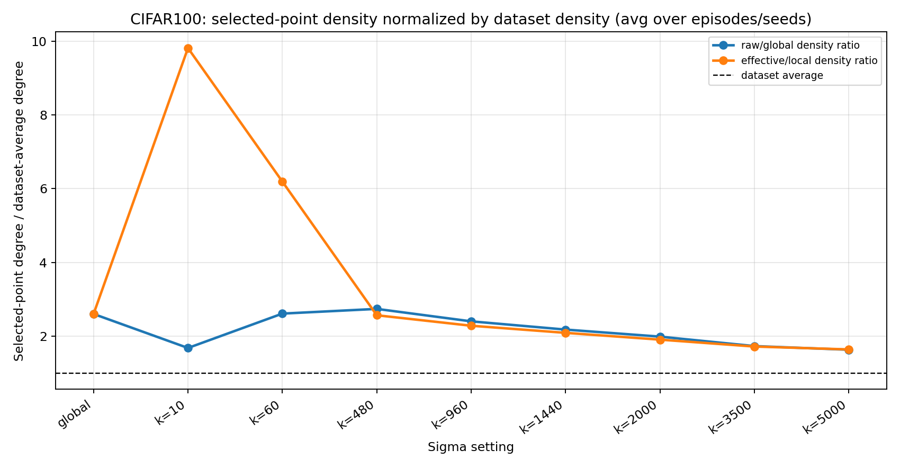

Figure 2 shows that MaxHerding selects points that are denser than the dataset average. This means MaxHerding naturally prioritizes central or high-coverage points. That is not necessarily bad: dense regions are representative and should be covered early. But it also means local sigma would need to do something nontrivial if we want it to improve sparse/dense balance.

### 5.2 Raw/Global Density Ratio

When comparing global sigma and local sigma, there is a subtle issue: each method uses a different graph. A point that is dense under a local graph may not be dense under the global graph.

To compare selected points using one common density notion, we measured raw/global density. This means we take the points selected by each method and re-measure their degree under the same raw/global ProbCover-style graph.

The raw/global density ratio is:

$$
\frac{\text{selected-point degree under a common raw/global graph}}{\text{dataset-average degree under that same raw/global graph}}
$$

This tells us whether local sigma selects points that are globally dense or globally sparse, independent of the local graph used during selection.

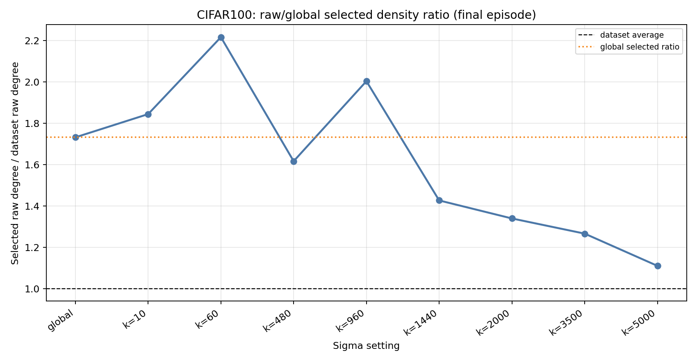

Figure 3 shows that local sigma can select points with lower raw/global density than global MaxHerding. However, under the local graph those same selected points can still look highly connected. This means local sigma changes the geometry of what counts as central or representative.

This behavior is important, but it did not translate into a strong robust accuracy gain. Locality changes selection behavior, but not always in a clearly beneficial way.

## 6. Second Direction: Density-Normalized Kernel

After seeing that graph degree seemed central, we tried modifying the kernel directly by normalizing by degree.

The symmetric version was:

$$
K_{ij} \leftarrow \frac{K_{ij}}{(\text{degree}_i \text{degree}_j)^{\alpha / 2}}
$$

Here:

- `degree_i` is the graph degree of point i.
- `alpha = 0` gives the original kernel.
- Larger alpha penalizes dense points more strongly.

The alpha shown in the result graphs is the same alpha in the formula above. It appears as `alpha / 2` because symmetric normalization splits the total penalty equally between the two endpoints.

The motivation was:

- MaxHerding tends to pick dense/central points.
- This may create redundancy.
- A controlled density penalty might encourage more balanced selection.

### 6.1 Fixed Alpha Results

We tested fixed alpha values:

```text
alpha = 0, 0.1, 0.25, 0.5, 0.75, 1.0
```

Alpha normalization can help at very low budgets, but it is not consistently helpful later.

For CIFAR100, the clearest gains appeared around 100 to 400 labels. Alpha=0.5 was often useful early, while later budgets preferred weaker alpha or alpha=0. Alpha=1.0 was too aggressive and collapsed performance. CIFAR10 showed a similar low-budget pattern around 20 to 30 labels, but CIFAR100 was the more informative setting because it had more room for improvement.

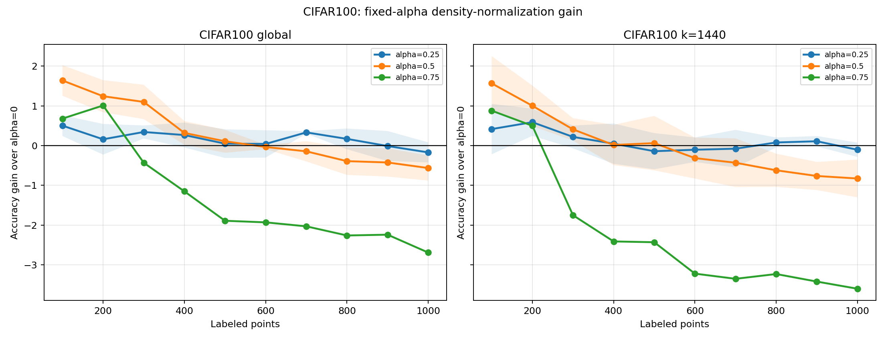

Figure 4 supports the idea that density is important. Penalizing dense points can help when the budget is extremely small, likely because it reduces redundant selection inside the densest regions. But dense regions are also representative, so penalizing them too much or for too long hurts later.

### 6.2 Delta Sensitivity

We then tested whether the density-normalization benefit depends on the cutoff `delta`.

For CIFAR100, we tested:

```text
delta = 0.55, 0.60, 0.65, 0.70, 0.75
```

The benefit of density normalization was sensitive to delta. Alpha=0.5 helped clearly at low budgets, especially from 100 to 300 labels. Smaller deltas preserved this gain longer, while larger deltas made alpha harmful later.

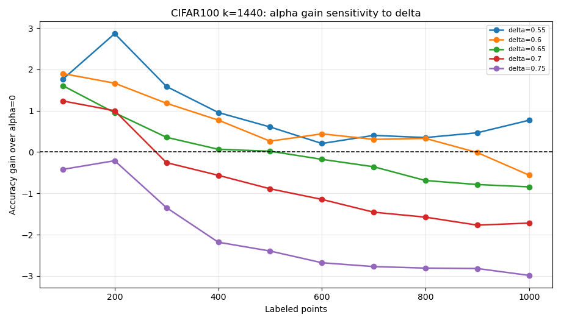

This reinforced that cutoff scale, graph degree, and density penalty interact. A fixed alpha and fixed delta are probably too rigid if the goal is to improve the whole active-learning trajectory.

### 6.3 Dynamic Alpha / Decay

Because fixed alpha helped early and hurt later, we tested simple dynamic alpha schedules:

- Early-only alpha.
- Linear decay.
- Three-phase decay.

The hope was to preserve early gains while avoiding late penalties.

The schedules preserved some early gains, especially on CIFAR100, but they did not improve final accuracy. They were too crude because they were fixed by episode number rather than by the actual graph degree, selected-set density, or coverage state.

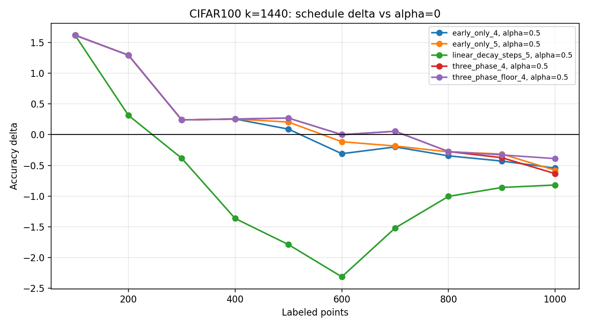

This suggested that if alpha should be dynamic, it should probably be chosen based on current graph statistics rather than a hand-written schedule.

## 7. Final Direction: Degree as the Main Explanatory Quantity

The previous experiments suggested that degree/density might be more important than locality itself. The final analysis focused on CIFAR100 MaxHerding with 1NN and asked:

Can MaxHerding behavior be explained better by graph degree/density than by K?

For completed CIFAR100 K-sweep runs, we extracted:

- Accuracy at each active-learning budget.
- The `(K, delta)` setting.
- Dataset effective degree.
- Degree of selected points.
- Degree of the remaining unlabeled pool after selection.

### 7.1 Retrospective K-Sweep Evidence

The first degree analysis was retrospective. We did not control degree directly. We took the completed K-sweep experiments and measured what graph degree each setting produced.

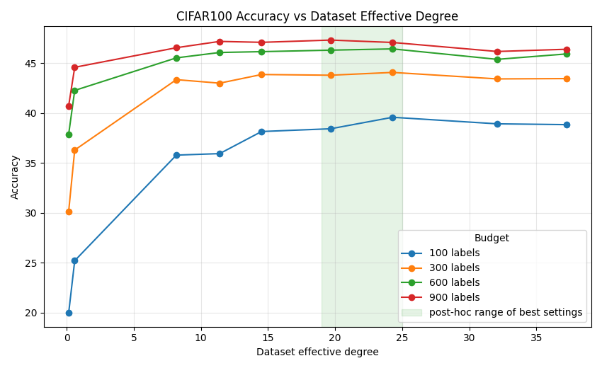

Each point is one completed K-sweep setting. The X value is the dataset effective degree induced by that setting. The Y value is the matching accuracy from the same setting at the same budget.

The shaded band is post-hoc. It was not controlled during the experiment. It marks the approximate degree range where strong K-sweep settings tended to appear.

Figure 7 shows that very small degree performs poorly. Higher degree helps more at early budgets, but the relationship is not monotone later. The caveat is that K and degree changed together, so this figure suggests a degree explanation but does not prove causality.

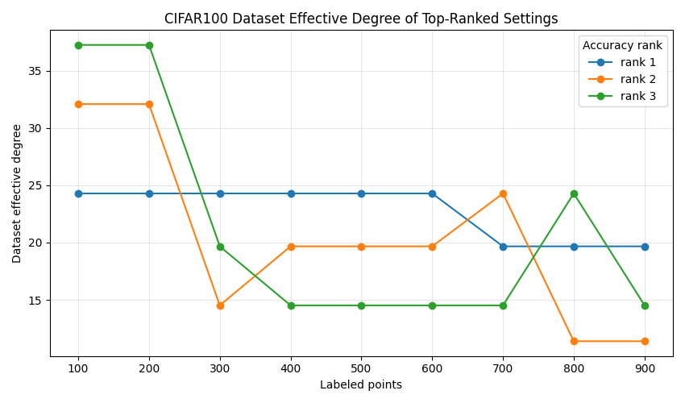

For each budget, we ranked all tested K-sweep settings by accuracy and plotted the dataset effective degree of the top three settings.

Figure 8 shows that the best K does not stay fixed. Early budgets favor settings with higher degree, while later budgets shift toward lower or moderate degree. This supports the idea that the useful object is a budget-dependent degree regime, not one fixed K.

### 7.2 Selection and Remaining-Pool Density

Selected-point degree gives a direct view of what MaxHerding chooses.

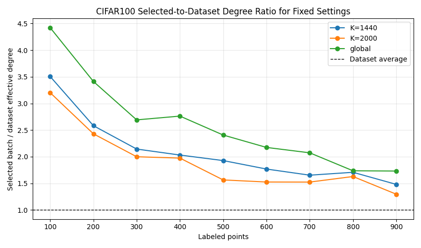

Figure 9 follows fixed settings through the full active-learning run: global sigma, K=1440, and K=2000.

The Y axis is:

$$
\frac{\text{selected batch effective degree}}{\text{dataset effective degree}}
$$

A value above 1 means selected points are denser than the dataset average.

For all three settings, MaxHerding selects much denser-than-average points early. The ratio decreases as budget grows, but remains above average for most of the run. This is one of the clearest pieces of evidence that degree/density is central to the algorithm.

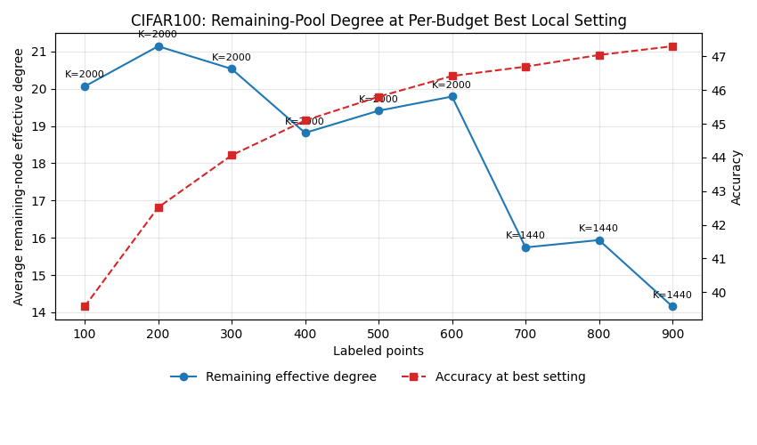

Figure 10 shows the average effective degree of the remaining unlabeled pool under the best local setting at each budget. The red curve shows the accuracy of that same setting.

Remaining-pool degree is useful because active learning changes the pool. If MaxHerding selects dense representative points early, then the remaining unlabeled pool should become less dense. This is what we observe.

Together, Figures 9 and 10 support the density explanation: selected points are denser than average, and after selection the remaining pool generally becomes less dense.

### 7.3 Controlled-Degree Experiment

The previous figures were useful but still retrospective. To test the degree hypothesis more directly, we ran a controlled-degree experiment.

Setup:

- Dataset: CIFAR100.
- Algorithm: MaxHerding.
- Classifier: 1NN.
- Seeds: 3, 4, and 5.
- Budget: 100 labels per episode, up to 1000 labels.
- Cutoff enabled.
- Different `(K, delta)` pairs chosen to target similar graph degrees.

The target degree bands were:

- Low degree: about 10-13 effective neighbors.
- Moderate degree: about 18-23 effective neighbors.
- High degree: about 30-36 effective neighbors.

The degree values were estimated before running active learning by sampling CIFAR100 points and measuring how many graph neighbors each `(K, delta)` setting produced.

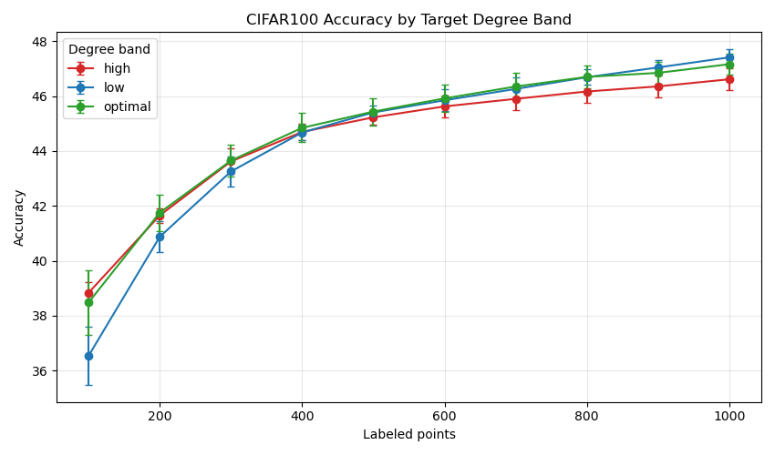

Figure 11 groups the controlled runs by target degree band and averages over configurations and seeds.

High degree is worse later in the active-learning run. Low and moderate degree are close and competitive. The useful conclusion is not "higher degree is better." Instead, too much degree can hurt, and MaxHerding seems to prefer a low-to-moderate degree regime on CIFAR100.

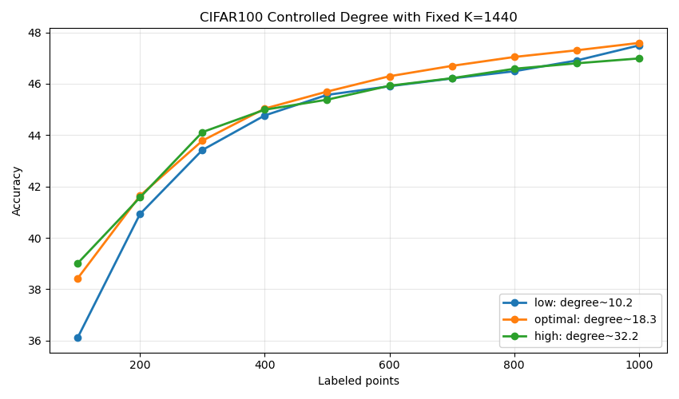

Figure 12 is the cleanest controlled figure. K is fixed to 1440, and delta changes the graph degree.

The moderate-degree setting is best for most of the budget range. High degree is not best later, and very low degree is weaker early. This supports a budget-dependent useful degree regime.

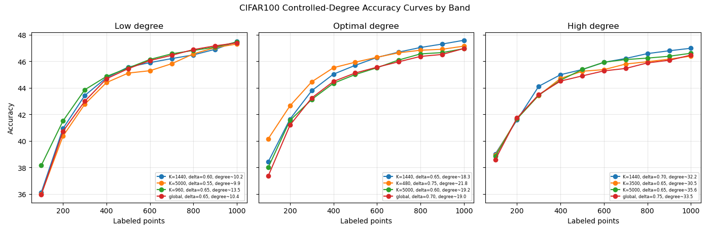

Curves within a degree band are relatively close, though not identical. This means degree explains a meaningful part of the behavior, but not everything. The exact K, delta, and feature-space geometry still have smaller effects.

## 8. Main Conclusions

The full research process supports the following conclusions:

- Local sigma changes MaxHerding behavior, but locality alone is not the main explanation.
- K matters mostly through the graph degree/density induced by the `(K, delta)` setting.
- Very small K or very low degree creates graphs that are too sparse.
- Very large K becomes closer to global sigma.
- MaxHerding naturally selects high-degree, dense, representative points early.
- The remaining unlabeled pool becomes less dense as active learning progresses.
- Density normalization can help at very low budgets, but often hurts later.
- Simple alpha decay schedules are too crude because they do not react to the actual graph state.
- Controlled-degree experiments show that too-high degree hurts later.
- The useful regime on CIFAR100 is low-to-moderate degree, roughly around 18-25 effective neighbors, but it is budget-dependent rather than globally fixed.

## 9. Open Questions and Future Directions

The current work gives a clearer explanation, but not a complete new algorithm.

The most natural next directions are:

- Choose K or delta adaptively to target a desired graph degree.
- Use selected-to-dataset degree ratio to decide when dense-region selection is too strong.
- Test whether the same degree-based explanation holds on other datasets.
- Separate degree from geometry more carefully by comparing kernels with matched degree but different local structure.
- Design adaptive density normalization based on current graph/selection statistics, rather than a fixed alpha schedule.

The main future algorithmic idea is:

Instead of manually tuning K, choose K or delta to maintain a useful graph degree regime as the active-learning budget changes.

## 10. Two-Minute Research Summary

We started by asking whether local sigma can improve MaxHerding active learning. The idea was motivated by local scaling in spectral clustering: one global kernel scale may not fit both dense and sparse regions, so maybe each point should have its own scale.

In practice, the experiments showed that K is not the real object we should focus on. Small K makes the graph too sparse and hurts accuracy. Large K behaves more like global sigma. The useful settings are better described by the graph degree/density induced by the `(K, delta)` pair.

This shifted the research from localization to density. We found that MaxHerding strongly selects high-degree points early. These are dense, representative points. As the run progresses, the selected points become less extreme and the remaining unlabeled pool becomes less dense. This suggests that MaxHerding is not only improving accuracy by adding labels, but also changing the density structure of the pool.

We then tested this more directly with controlled-degree experiments on CIFAR100. Different `(K, delta)` pairs were chosen to target low, moderate, and high degree bands. The results showed that degree matters, but not monotonically: very high degree hurts later, very low degree can be weak early, and the best behavior is usually in a low-to-moderate regime. On CIFAR100 this useful region is roughly around 18-25 effective neighbors, but the best point shifts with budget.

The final takeaway is that local sigma is useful mainly as a way to control graph density. The next natural step is not to search for one best K, but to design an adaptive rule that chooses K or delta according to the graph degree regime needed at the current budget.
