# Research Summary: The Effect of Locality and Density on Coverage-Based Active Learning

## Executive Summary

This project studied whether local kernel scaling can improve active learning, especially when the label budget is small. The starting motivation was that one global similarity scale may not fit both dense and sparse regions of the data.

The main finding is that locality by itself does not explain the behavior. The strongest explanatory variable we found is the graph degree induced by the kernel and cutoff. If the graph is too sparse, MaxHerding cannot cover enough neighbors. If the graph is too dense, many points look too similar and dense regions can dominate. The useful regime is between these extremes.

The research therefore shifted from asking which local-sigma K is best to asking what graph degree or density profile the active learning method should induce at each budget. On CIFAR100, the strongest settings usually lie in a low-to-moderate effective-degree regime, roughly around 18-25 neighbors, but this is budget-dependent rather than one fixed optimum.

## 1. Background: Active Learning

Active learning is useful when unlabeled data is cheap but labels are expensive. In pool-based active learning, the algorithm starts with a fixed unlabeled pool and repeatedly chooses which points should be labeled. The total number of labels allowed is the budget.

We focused on low-budget active learning, where every selected point matters. The main ranges were 10-100 labels for CIFAR10 and 100-1000 labels for CIFAR100.

### 1.1 CIFAR10 And CIFAR100

CIFAR10 and CIFAR100 are standard image-classification benchmarks. CIFAR10 has 10 object classes, while CIFAR100 has 100 finer-grained classes.

We used both datasets, but most final analysis focuses on CIFAR100. CIFAR10 reaches high accuracy with few labels in many baselines, leaving less room for improvement. CIFAR100 is harder and makes differences in selection behavior easier to study.

### 1.2 What Makes A Good Active Learning Selection?

A good selected set should be representative, diverse, and useful for classification.

The key tension is between dense and sparse regions:

- Dense regions contain many representative points
- Selecting too many dense points can be redundant
- Sparse regions may contain rare or important structure
- Selecting too many outliers can waste budget

Much of the project tries to understand how MaxHerding balances this tradeoff.

### 1.3 Feature Space

The algorithms usually operate on fixed SSL/SimCLR feature vectors rather than raw pixels. Each image is embedded into a vector, and distances or similarities are computed in that feature space.

This means the active learning algorithm depends strongly on the geometry of the feature representation.

### 1.4 Kernels, Graphs, And Degree

Coverage-based methods often build a similarity graph over the dataset. Each point is a node, and edges represent similarity.

An RBF kernel converts distance into similarity:

$$K_{ij} = \exp\left(-\frac{d(i,j)^2}{\sigma^2}\right)$$

The parameter sigma controls the scale. Small sigma creates a more local graph. Large sigma creates a smoother graph where many points are similar.

The degree of a point measures how connected it is. In a weighted graph:

$$\text{degree}(i) = \sum_j K_{ij}$$

High-degree points are usually central or dense. Low-degree points are usually sparse or isolated. In our cutoff experiments, degree is induced by the full `(K, delta)` setting: K determines the local scale, and delta determines which connections remain.

### 1.5 The Self-Tuning Spectral Clustering Paper

The local-sigma idea comes from Self-Tuning Spectral Clustering by Zelnik-Manor and Perona. That paper used a local scale for each point:

$$\sigma_i = \text{distance from point } i \text{ to its K-th nearest neighbor}$$

and then computed affinity as:

$$A_{ij} = \exp\left(-\frac{d(i,j)^2}{\sigma_i\sigma_j}\right)$$

The motivation is that dense and sparse regions should not necessarily use the same global scale. This motivated our question: can a similar local scaling help MaxHerding choose better points in active learning?

The important difference is that the original paper used local scaling for clustering, while we use it for selecting labeled points under a budget. In MaxHerding, K strongly changes graph degree, so it becomes part of the algorithmic behavior rather than just a clustering parameter.

### 1.6 ProbCover

ProbCover builds a binary graph using a distance threshold:

$$
\text{edge}(i,j) =
\begin{cases}
1, & d(i,j) \leq \text{threshold} \\
0, & d(i,j) > \text{threshold}
\end{cases}
$$

It then greedily selects points that cover many uncovered neighbors.

We used the same threshold idea as a cutoff inside MaxHerding:

$$
K_{ij} =
\begin{cases}
\text{RBF similarity}, & d(i,j) \leq \text{threshold} \\
0, & d(i,j) > \text{threshold}
\end{cases}
$$

This keeps MaxHerding smooth for nearby points, but removes very distant connections.

### 1.7 MaxHerding

MaxHerding selects representative points using a smooth kernel matrix. A point is useful if it helps represent or cover the unlabeled distribution.

Therefore, MaxHerding depends strongly on the kernel:

- Too sparse: selected points cover too few neighbors
- Too dense: many points become too similar
- Too biased toward dense regions: selection may become redundant

This is why we studied sigma, local sigma, cutoff, graph degree, and density normalization.

## 2. Research Goal

The project started with this question:

> Can local sigma improve MaxHerding by adapting the similarity scale to local data density?

The hypothesis was that local sigma could better balance dense and sparse regions than one global sigma.

After the experiments, the question became sharper:

> Is the important factor locality itself, or the graph degree/density induced by the kernel?

The current evidence points mostly to graph degree.

## 3. Experimental Setup

The main validated setup was:

- Method: MaxHerding
- Classifier: 1-nearest neighbor on SSL features
- Features: fixed SimCLR/SSL features
- Kernel: RBF kernel
- Cutoff: ProbCover-style cutoff
- Datasets: CIFAR10 and CIFAR100
- Budgets: 10-100 for CIFAR10 and 100-1000 for CIFAR100

This setup was used because global-sigma MaxHerding with 1NN reproduced the expected reference behavior most reliably.

## 4. First Direction: Local Sigma Through K

We first varied the local-sigma K. For each point, sigma is based on the distance to its K-th nearest neighbor. Small K gives a very local scale; large K becomes smoother and more global-like.

### Main Result

K mostly controls graph density.

- Small K makes the graph too sparse and hurts accuracy
- Large K makes local sigmas similar and behaves close to global sigma
- Medium-to-large K gives the useful region

The strongest regions were approximately:

- CIFAR10: K around 3500
- CIFAR100: K around 1440

On CIFAR100, the best local K improved over global sigma across the 100-1000 label range, especially at early budgets.

### Interpretation

The effect of local sigma is largely explained by the graph degree it induces. This suggests K is less important as a value by itself, and more important because it changes the connectivity of the kernel graph.

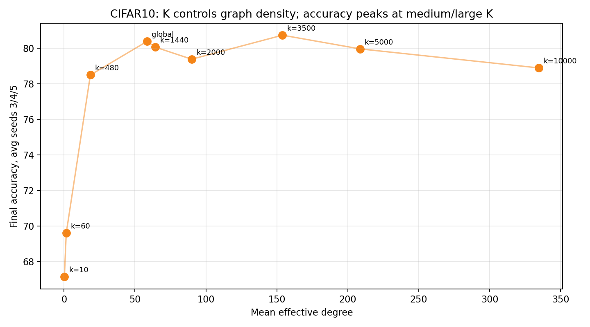{width=5.83333in}

Figure 1. Effective degree versus final accuracy for CIFAR10.

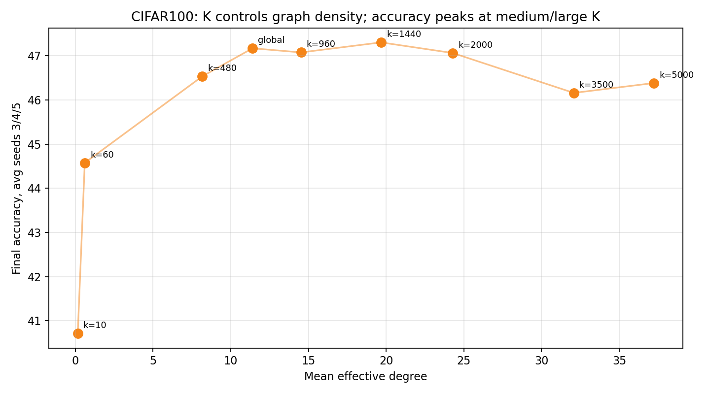{width=5.83333in}

Figure 2. Effective degree versus final accuracy for CIFAR100.

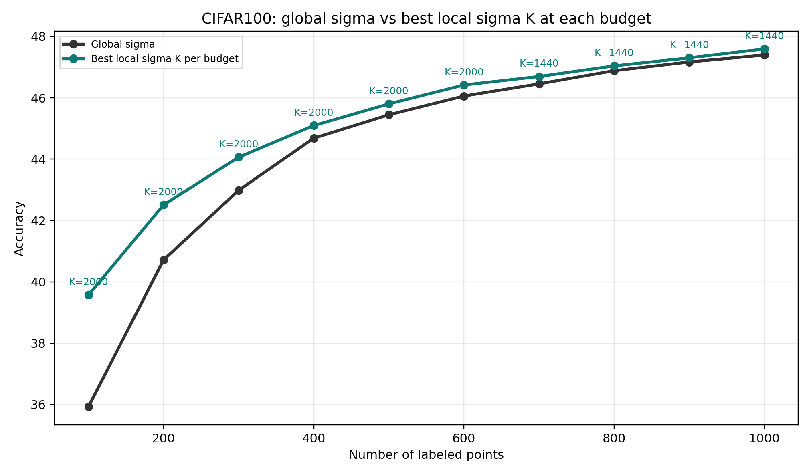{width=5.83333in}

Figure 3. CIFAR100 global sigma compared with the best local-sigma K at each budget.

Figure 3 shows the budget dependence directly. The best K is not fixed across the run, but the local-sigma setting improves the global reference in the averaged CIFAR100 results.

## 5. Density and Selection Diagnostics

To understand what MaxHerding selects, we measured dataset degree, selected-point degree, selected degree normalized by dataset-average degree, label diversity, local sigma statistics, and accuracy.

### Main Findings

MaxHerding tends to select points that are denser than the dataset average. This is expected because high-degree points cover many neighbors, but it can also create redundancy.

### Local Sigma Versus Global Selection

Local sigma changes which points appear central. Some points that are not globally dense can become locally central under the local graph.

The key diagnostic is selected-point degree divided by dataset-average degree. Values above 1 mean the algorithm selects points denser than a typical dataset point.

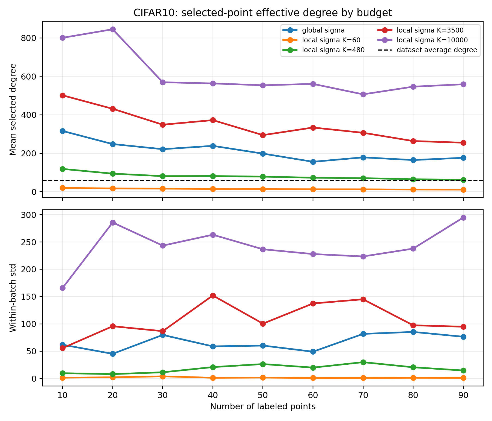{width=5.84483in}

Figure 4. Selected-point effective degree by budget for CIFAR10.

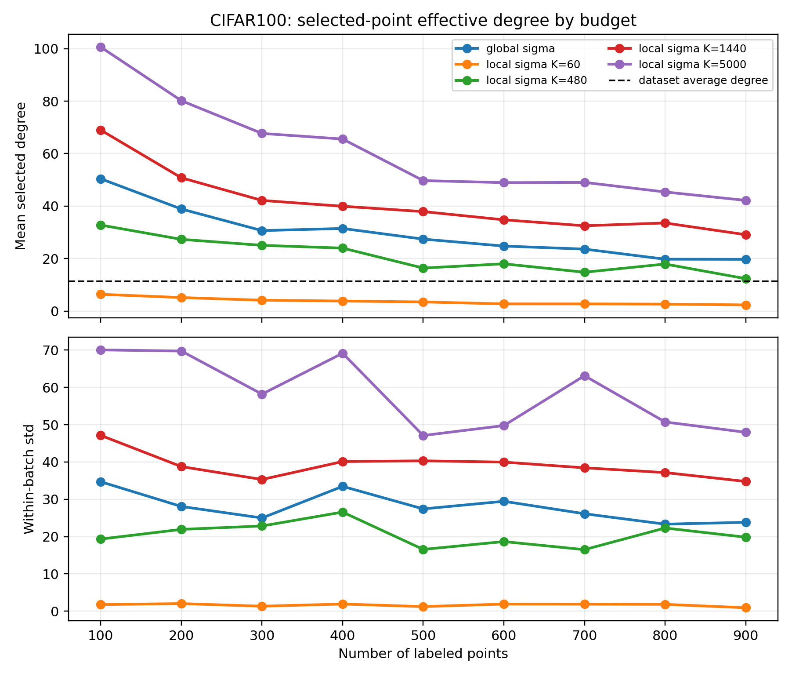{width=5.85343in}

Figure 5. Selected-point effective degree by budget for CIFAR100.

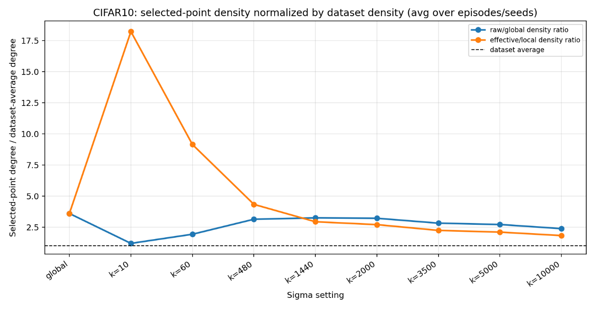{width=5.83333in}

Figure 6. Selected-point degree normalized by dataset-average degree for CIFAR10.

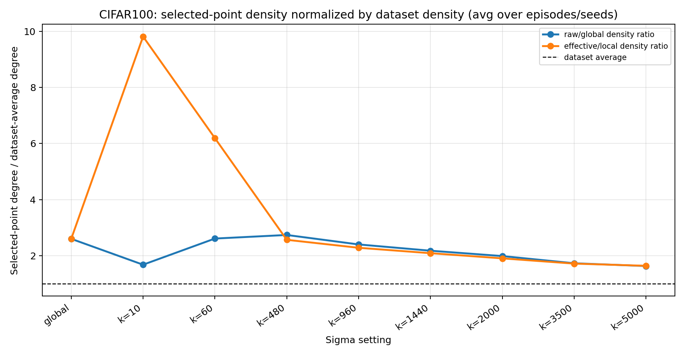{width=5.83333in}

Figure 7. Selected-point degree normalized by dataset-average degree for CIFAR100.

Figures 6 and 7 show that selected points are usually more connected than average. Local sigma changes this behavior, but does not automatically create a strong accuracy gain.

## 6. Second Direction: Density-Normalized Kernel

Because degree seemed central, we tried explicitly penalizing high-degree points in the kernel:

$$
K_{ij} \leftarrow
\frac{K_{ij}}{\left(\text{degree}_i \text{degree}_j\right)^{\alpha/2}}
$$

Here alpha controls the strength of the density penalty.

- alpha=0 gives the original kernel
- larger alpha penalizes dense points more strongly
- alpha/2 appears because symmetric normalization splits the total alpha penalty equally between the two endpoints

We tested effective and weighted degree. Their results were very similar, so the main effect appears to be penalizing connectivity in general rather than the exact degree definition.

## 7. Fixed Alpha Results

We tested fixed alpha values for global sigma and the best local K settings.

### Main Result

Density normalization improved the very low-budget regime when alpha was chosen appropriately.

- CIFAR10: clearest gains around 20-30 labels
- CIFAR100: clearest gains around 100-400 labels
- alpha=1 was too aggressive and usually harmed performance

### Interpretation

Density normalization can reduce redundant dense-region selection early. Later, dense regions are still important for representation, so too much normalization becomes harmful.

The best alpha is therefore budget-dependent.

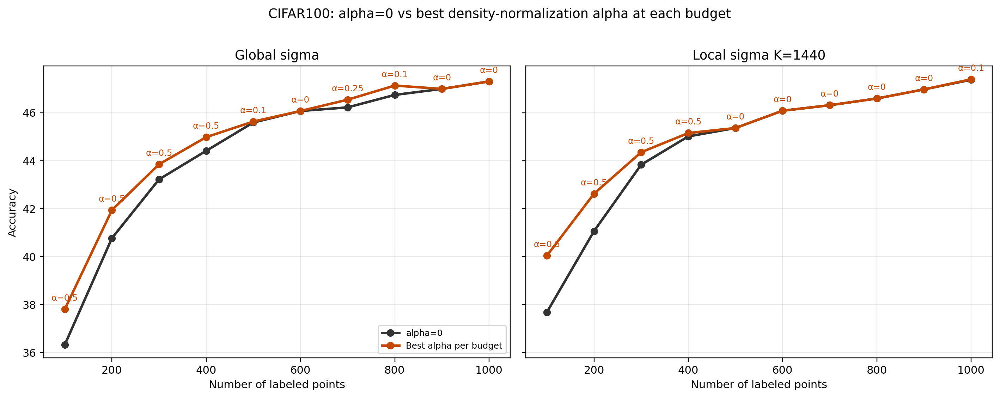{width=5.83333in}

Figure 8. CIFAR100 alpha=0 compared with the best alpha at each budget.

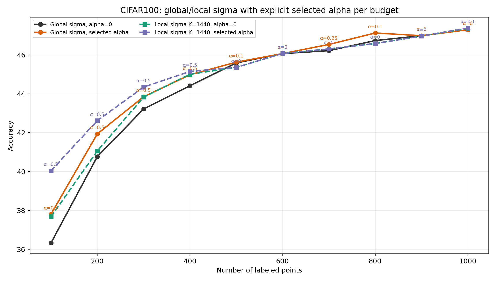{width=5.83333in}

Figure 9. CIFAR100 global/local sigma with alpha=0 and selected alpha at each budget.

These figures show that alpha=0.5 is often useful early for CIFAR100, especially with local K=1440, while later budgets usually prefer alpha=0.

### Delta Sensitivity And ProbCover Comparison

We also tested whether the alpha effect depends on the cutoff delta. ProbCover was used as a binary coverage baseline because both methods rely on graph connectivity, but ProbCover uses hard coverage while MaxHerding uses weighted similarity.

The qualitative result was stable: delta changes the size of the alpha effect, but density normalization still helps mainly early and weakens later.

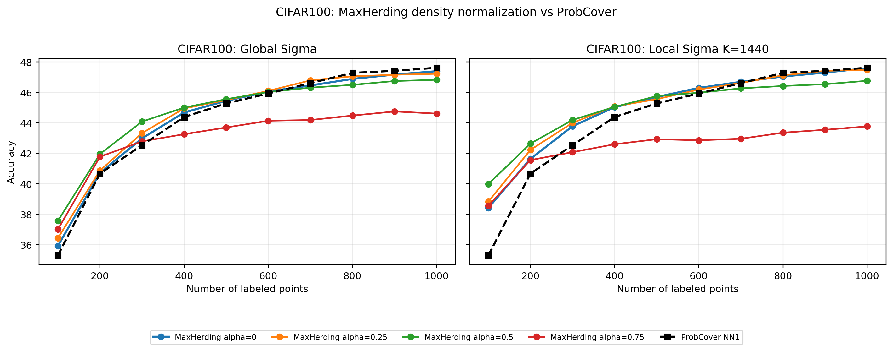{width=5.84081in}

Figure 10. CIFAR100 MaxHerding density normalization compared to ProbCover.

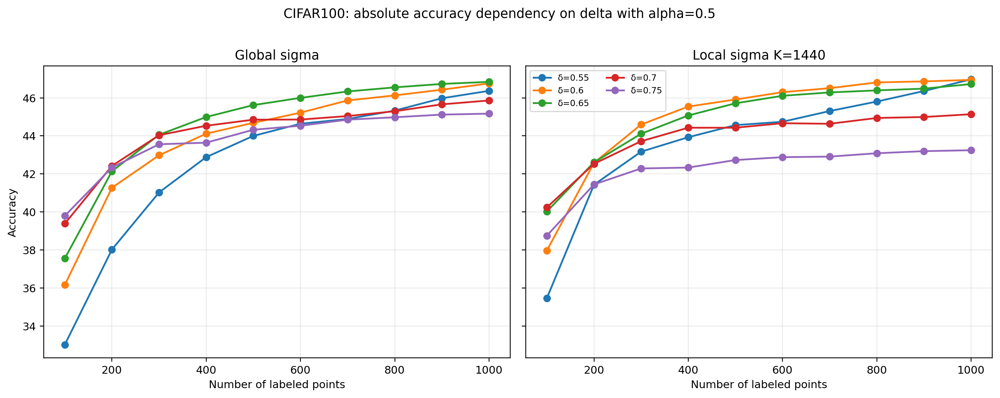{width=5.83333in}

Figure 11. CIFAR100 absolute accuracy across delta values with alpha=0.5.

## 8. Third Direction: Dynamic Alpha / Decay

Because fixed alpha helped early but hurt later, we tested simple schedules:

- Early-only alpha
- Linear decay
- Three-phase decay

The goal was to keep early gains while avoiding late penalties.

### Main Result

The simple decay schedules did not improve final accuracy. They preserved some early gains, especially on CIFAR100, but none solved the late-budget problem.

### Interpretation

The issue is that these schedules depend only on episode number. They do not react to the actual graph state, selected-set density, or coverage signal.

This suggests that a useful adaptive rule should choose alpha from measured statistics, not from a fixed schedule.

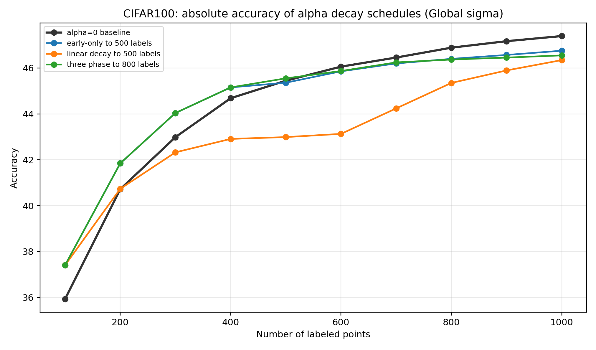{width=5.83333in}

Figure 12. CIFAR100 alpha decay schedules with global sigma.

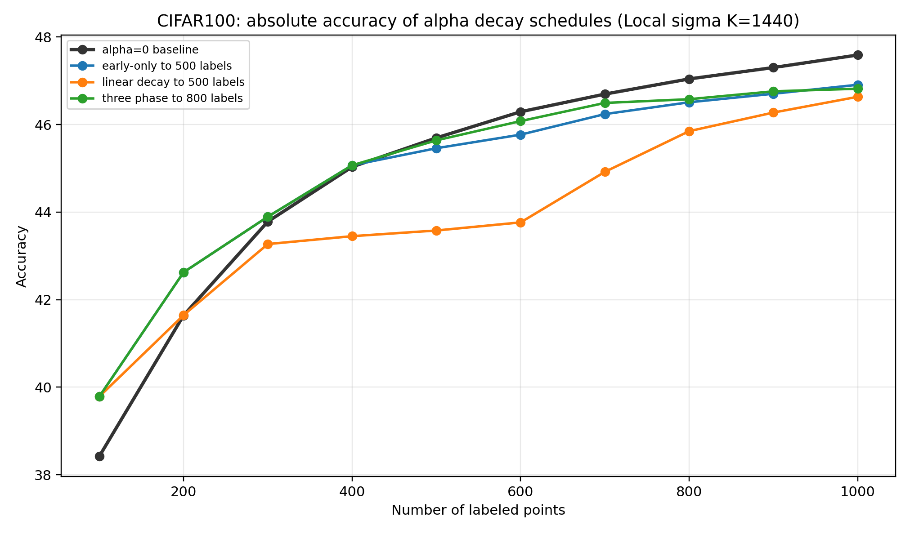{width=5.83333in}

Figure 13. CIFAR100 alpha decay schedules with local-sigma K=1440.

## 9. Main Scientific Conclusion So Far

The evidence suggests:

- Local sigma affects MaxHerding mainly by changing graph degree
- Very sparse graphs perform badly
- Very dense graphs behave closer to global sigma or become redundant
- Medium-degree graphs are most useful
- MaxHerding naturally selects high-degree points
- Density normalization improves very low-budget performance when alpha is chosen carefully
- The best density penalty changes with budget
- Simple fixed decay schedules are too crude

The central conclusion is that graph degree is the clearest measurable variable for understanding and improving the method.

## 10. What We Can Learn

The research direction changed from tuning K manually to understanding and controlling graph structure.

A better question is:

> What graph degree or density profile should the algorithm induce at each budget?

Possible controls include target effective degree, selected/dataset degree ratio, budget-dependent alpha, and adaptive cutoff.

### Final Degree-Control Evidence

To test the degree explanation more directly, we analyzed CIFAR100 K-sweep results and then ran controlled-degree experiments.

First, we plotted accuracy against the effective degree induced by each completed setting.

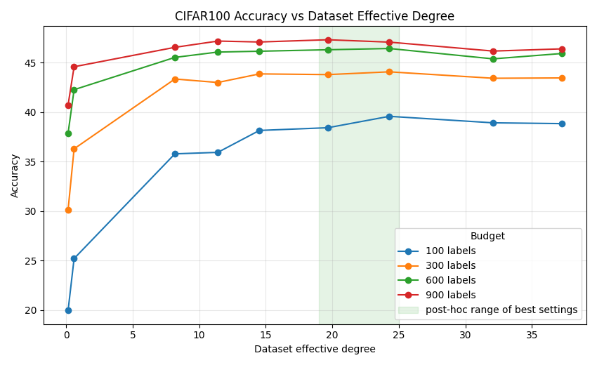{width=5.83333in}

Figure 14. CIFAR100 accuracy versus dataset effective degree.

Very small degree performs poorly. Higher degree helps early, but the relationship is not monotone later. This supports the idea that degree is a better explanatory variable than K alone.

Then we controlled degree more directly using different `(K, delta)` pairs to target low, moderate, and high graph-degree bands.

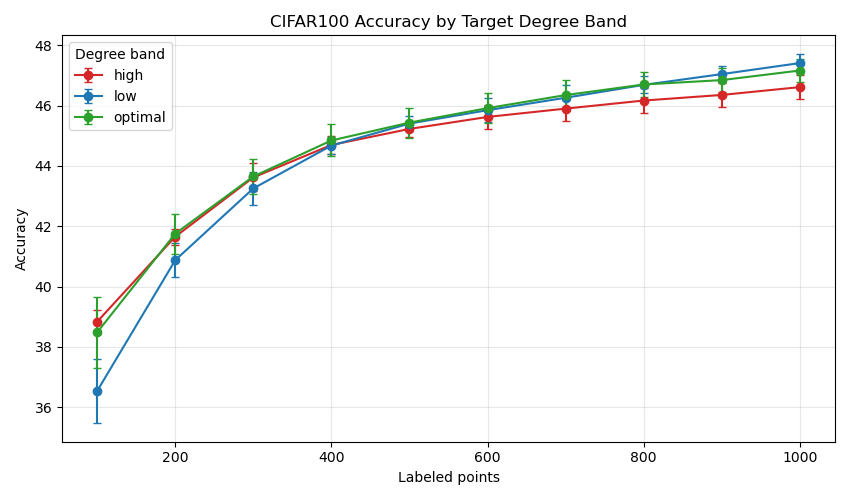{width=5.83333in}

Figure 15. CIFAR100 controlled-degree accuracy by target degree band.

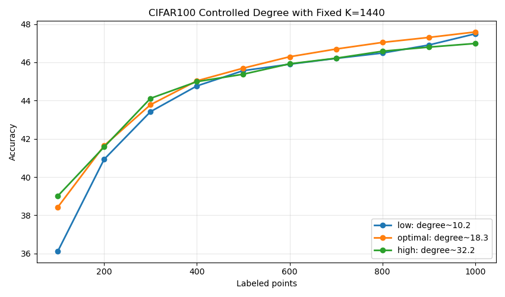{width=5.83333in}

Figure 16. CIFAR100 controlled-degree curves with fixed K=1440.

These results show that higher degree is not always better. On CIFAR100, the best behavior is usually in a low-to-moderate degree regime, roughly around 18-25 effective neighbors, and the best point within that regime changes with budget.

## 11. Open Questions

The project leaves several open questions.

### 11.1 Generality Across Datasets

Does degree remain the main explanatory variable on larger or different datasets, such as Tiny ImageNet, STL10, or ImageNet subsets?

### 11.2 Degree Versus Locality

If two kernels have similar degree distributions, do they produce similar selections even if one is global and one is local? This is the key question for separating locality from density.

### 11.3 Selection Dynamics Across Budget

Why does density normalization help early and hurt later? The answer may depend on how the selected set changes from dense representative points to more diverse or sparse points.

### 11.4 Best Statistic For Prediction

Candidate predictive statistics include dataset degree, selected-point degree, selected/dataset degree ratio, local sigma variation, selected label entropy, and class diversity.

### 11.5 Better Adaptive Rules

The next useful algorithm may choose K, delta, or alpha dynamically based on graph statistics rather than fixing them before the run.

## 12. Future Research Directions

### 12.1 Degree-Targeted Active Learning

Choose K or sigma to hit a target effective degree instead of tuning K manually.

### 12.2 Adaptive Density Penalization

Choose alpha based on selected-set density or selected/dataset degree ratio, so density normalization is used only when dense-region redundancy is too strong.

### 12.3 Separating Degree From Geometry

Compare kernels with matched degree but different locality structure to test whether locality has an independent benefit.

### 12.4 Dataset Scaling Study

Repeat the analysis on larger datasets to test whether the degree-dominance phenomenon is CIFAR-specific.

### 12.5 Selection-Set Geometry Analysis

Analyze the geometry of the full selected set: pairwise distances, class coverage, cluster coverage, and redundancy.

## 13. Short Thesis-Style Takeaway

We began by testing whether local sigma and K could improve MaxHerding by adapting the kernel to local data density. The experiments showed that locality alone is not the main story. Local sigma mainly matters because it changes the graph induced by the kernel, especially the effective degree of points.

This explains the main results: small K fails because the graph is too sparse, large K behaves close to global sigma, density normalization helps when dense-region selection is too dominant, and simple alpha decay fails because it does not react to the actual graph state.

The strongest final evidence comes from CIFAR100 degree-control experiments. They show that too-high degree can hurt later, while low-to-moderate degree is usually strongest. The useful regime is roughly 18-25 effective neighbors, but it changes with budget.

The main lesson is that future work should focus less on manually tuning K and more on controlling graph density, cutoff scale, and selected-set density through adaptive rules.
